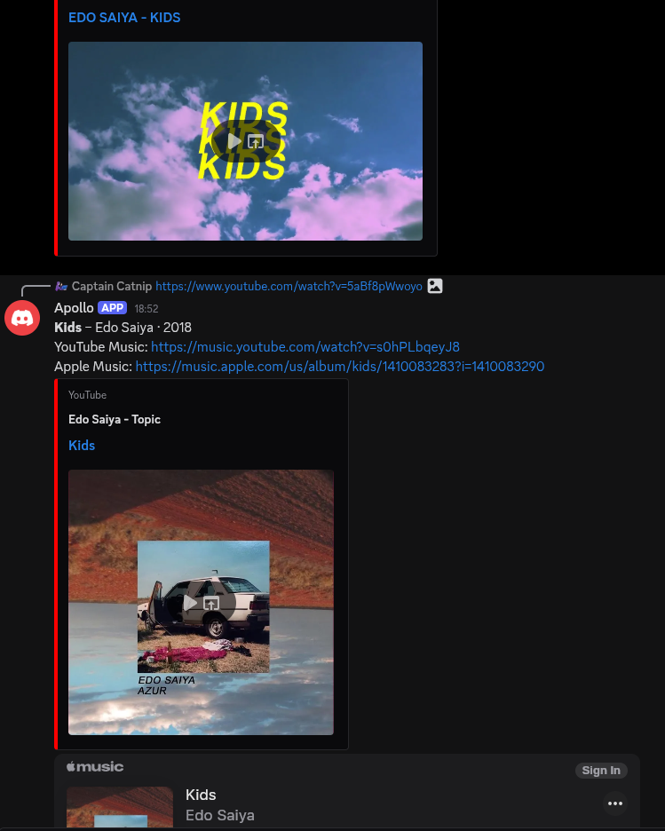
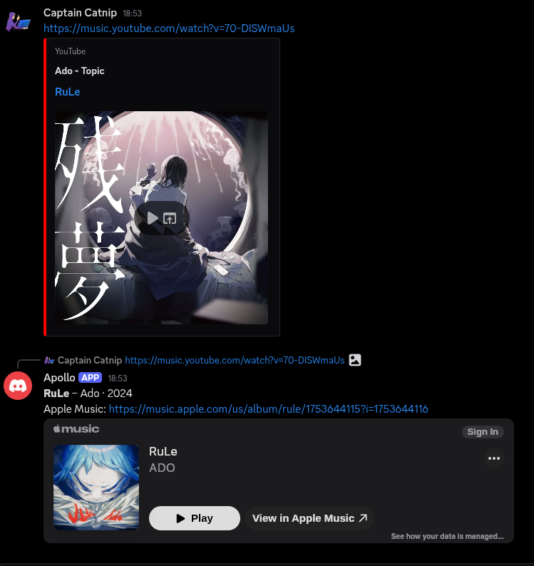
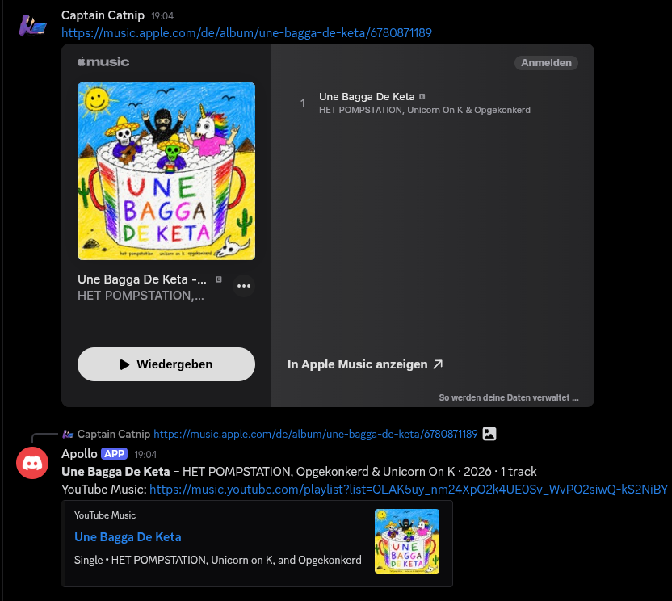

# Music Translator

A Discord bot that recognizes music links (~~Spotify~~, Apple Music, YouTube Music, …) in chat and replies with links to the same track on other platforms.

Examples are available [here](./docs/examples.md)
## Sources 

### YouTube Videos



### YouTube Music



### Apple Music


## Setup

1. Create an application and bot at <https://discord.com/developers/applications> and enable the **Message Content** intent.
2. Create a YouTube Data API v3 key in the [Google Cloud Console](https://console.cloud.google.com/apis/library/youtube.googleapis.com).
3. Copy `.env.example` to `.env` and fill in `DISCORD_TOKEN` and `YOUTUBE_API_KEY`. Without `YOUTUBE_API_KEY` YouTube Music is disabled, which leaves the bot with no platform to translate to until another one is added.
4. Run with [just](https://github.com/casey/just), which loads `.env` automatically:
   ```sh
   just run
   ```
   Other recipes: `just build`, `just test`, `just lint`, `just tidy`.

## Layout

```
main.go             entry point
internal/config/    environment-based configuration
internal/bot/       Discord session and event handlers
internal/platform/  music platform abstraction and link detection
  applemusic/       Apple Music (iTunes Search/Lookup API + website search, no credentials)
  youtubemusic/     YouTube Music and YouTube videos (YouTube Data API v3 + YouTube Music's internal API for albums and music videos)
```

## Supported links

| Platform | Recognized links |
|---|---|
| Apple Music | `music.apple.com/{country}/song/…/{id}`, `music.apple.com/{country}/album/…?i={trackId}`, albums: `music.apple.com/{country}/album/…/{albumId}` |
| YouTube Music | `music.youtube.com/watch?v={id}`, albums: `music.youtube.com/playlist?list=OLAK5uy_…`, `music.youtube.com/browse/MPREb_…` |
| YouTube | videos that are music: `youtube.com/watch?v={id}` (also `www.`, `m.`), `youtu.be/{id}`, `youtube.com/shorts/{id}`, `youtube.com/live/{id}` |

Album links are translated to albums, so the album link of a single finds the single, not the song. If a platform only has the song on an album, the single is "not found" there.

## Notes

- **Spotify support is postponed.** The Spotify Web API requires the developer account owner to have Spotify Premium, so Spotify links aren't supported yet.
- **Short links that redirect are not supported yet** (e.g. `spotify.link`). They have to be resolved by following their redirect first.
- **YouTube video links are only answered if the video is music and another platform has it.** A video counts as music if YouTube Music knows it as a music video or track, if it's on an "Artist - Topic" channel, or if its uploader put it in the Music category. Everything else is ignored silently: other videos, music uploads in other categories, covers and mixes that no other platform has, and videos that couldn't be looked up (e.g. when the quota is used up). Replies also link the track on YouTube Music, since video links open in YouTube. Each YouTube link costs 1 quota unit even if the video turns out not to be music, so only the first 2 video links of a message are looked up.
- **YouTube metadata quality varies.** Tracks that YouTube auto-generates from official releases ("Artist - Topic" channels) have exact title, artists and release year. For official music videos, the bot asks YouTube Music's internal API for the song and looks up its auto-generated track (1 more quota unit). For other videos, artist and title are guessed from the video title and channel name, and the release year is taken from the other platforms.
- **YouTube Music albums and music videos use an unofficial API.** The YouTube Data API's search doesn't return albums and knows nothing about the songs in music videos, so album searches, `browse/MPREb_…` links and music video lookups go through InnerTube, the internal API of the YouTube Music website. It needs no key and costs no quota, but it's undocumented and can change without notice; if it breaks, album replies show "Couldn't search YouTube Music", and music videos fall back to guessing artist and title from the video. The client version it sends is in `internal/platform/youtubemusic/innertube.go` and may need bumping eventually. An album search costs 1 Data API quota unit (for track counts), looking up an album link 3.
- **YouTube searches are expensive.** Each search costs 100 of the API's 10,000 free daily quota units, so the bot can translate about 100 Apple Music links to YouTube Music per day. Looking up a YouTube Music link costs only 1 unit, or 2 for a music video.
- **Apple Music searches use the US catalog**, since a YouTube Music link doesn't say which country's catalog to use.
- **Apple Music search falls back to the website.** The iTunes Search API is missing some releases that are on Apple Music. If it finds no match, the bot searches `music.apple.com` and reads the track IDs from the results page. That page isn't an official API, so this can break if Apple changes it.
